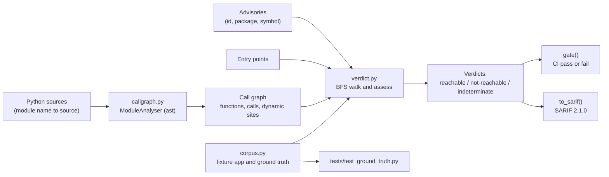

# reachable

Static call-graph reachability for vulnerability triage, with a three-state verdict (reachable / not-reachable / indeterminate) that never silently says "safe".

[](https://github.com/SlateGitOrg/reachable/actions/workflows/ci.yml)

## Why

A dependency scanner can report hundreds of CVEs, and most of them sit in code your application never executes. Treating them all equally burns weeks on upgrades that were never needed and buries the few that are exploitable.

Reachability analysis fixes that by asking whether any application entry point can actually call the vulnerable function named in the advisory. Done naively in Python it is dangerous: `getattr`, dynamic imports and decorators defeat static resolution, and a confident "not reachable" on something that is reachable closes a real vulnerability as noise. `reachable` therefore has three outcomes, and anything it cannot resolve is reported as `indeterminate` instead of being dropped.

## Features

- Call-graph construction from Python source with the standard-library `ast` module (imports, aliased imports, decorators, nested functions and classes).
- Breadth-first reachability from declared entry points to the advisory's vulnerable symbol, with the exact call chain for every reachable finding.
- Three-state verdicts. Unbounded dispatch (`getattr`, `eval`, `exec`, `__import__`, `importlib`, `globals`, `locals`, `vars`, `compile`) taints the reachable set, so any "not reached" result becomes `indeterminate`.
- Advisories that name no vulnerable symbol are always `indeterminate`, because they cannot be reachability-filtered.
- A count of unresolved method-call receivers in the reachable set, reported with every run so the analyser's blind spots are a number, not a secret.
- A CI gate (`fail_on` `reachable` or `actionable`) and SARIF 2.1.0 output that omits only `not-reachable` findings.
- No runtime dependencies: Python standard library only.

## Architecture



`callgraph.py` parses each module and records, per function, its resolved call targets, its dynamic call sites and its unresolved receivers. `verdict.py` walks the graph breadth-first from the entry points, remembering which nodes were reached through a frame that also contained a dynamic call, and then classifies each advisory. `corpus.py` holds a small fixture application with hand-verified expected verdicts that the tests assert against. See [docs/ARCHITECTURE.md](docs/ARCHITECTURE.md) for decisions and failure modes.

## Quick start

Requires Python 3.11 or newer. Nothing to install.

```bash
git clone https://github.com/SlateGitOrg/reachable.git
cd reachable
python -m src.demo                       # run the demo
python -m unittest discover -s tests -v  # run the tests
```

## Usage

`python -m src.demo` analyses the fixture application twice: as written, and again with a single `getattr()` added to a handler. Trimmed output:

```text
  Application as written
       advisory        package      severity   verdict
  !! OSV-2026-0001   imagelib     critical   reachable
       app.main.main -> app.handlers.handle_upload -> imagelib.decode_png
     OSV-2026-0002   imagelib     high       not-reachable
     OSV-2026-0003   yamllib      critical   not-reachable
  ...
    reachable 2   indeterminate 1   not reachable 5
    triage load: 3/8   gate: FAIL

  The SAME application, with one getattr() added
  ? OSV-2026-0002   imagelib     high       indeterminate
  ? OSV-2026-0003   yamllib      critical   indeterminate
  ...
    reachable 2   indeterminate 6   not reachable 0
    triage load: 8/8   gate: FAIL
```

The same API from Python:

```python
from src.callgraph import analyse_sources
from src.verdict import Advisory, assess, gate, to_sarif

graph = analyse_sources({"app.main": "import lib\n\ndef main():\n    lib.parse()\n",
                         "lib": "def parse():\n    pass\n"})
adv = [Advisory("OSV-X", "lib", "lib.parse", "demo advisory", "high")]
verdicts = assess(graph, ["app.main.main"], adv)
print(verdicts[0].reachability.value, verdicts[0].path)   # reachable ('app.main.main', 'lib.parse')
print(gate(verdicts).passed)                              # False
sarif = to_sarif(verdicts)
```

## How it works

- **Import resolution.** `import a.b` binds only the top-level name `a`; the rest of the path is resolved at the call site. Binding `a` to `a.b` would corrupt every other `a.*` call in the module. `import a.b as x` binds `x` to `a.b`.
- **Two kinds of "cannot resolve".** Unbounded dispatch (`getattr`, `eval`, dynamic import, and so on) could land anywhere, so it taints everything reached through that frame. A method call on a value the analyser cannot type (for example `hashlib.sha256(x).hexdigest()`) is bounded, and is counted and reported without tainting. Treating those as unbounded would turn nearly every verdict into `indeterminate`.
- **Decorators are calls.** A decorator that resolves to a name becomes a call edge; one that does not is recorded as a dynamic site.
- **Verdict order.** No symbol means `indeterminate`; symbol reached means `reachable` with its path; not reached but the reachable set contains a dynamic site means `indeterminate`; otherwise `not-reachable`.
- **Gate.** `fail_on="reachable"` fails only on reachable findings; `"actionable"` also fails on indeterminate ones.

## Testing

```bash
python -m unittest discover -s tests -v
```

18 tests cover: every verdict on the fixture matching its hand-verified answer, the zero-false-negative contract, a single `getattr` degrading every safe verdict to `indeterminate`, symbol-less advisories, call-graph construction (imports, transitive calls, decorators, dynamic sites), the gate, and SARIF output. The ground truth is a fixture of 8 advisories over a small application, so it demonstrates the behaviour rather than measuring accuracy on real-world code.

## Project layout

```text
src/
  callgraph.py   AST call-graph construction, dynamic-site detection
  verdict.py     reachability walk, three-state verdicts, gate, SARIF
  corpus.py      fixture application, advisories, hand-verified expectations
  demo.py        runnable demo (python -m src.demo)
tests/
  test_ground_truth.py
docs/
  ARCHITECTURE.md
```

## Limitations

- Python source only, analysed statically; there is no type inference, so method calls on untyped receivers are counted but not followed.
- Advisories are provided as in-memory objects. There is no OSV client, lockfile parser or command-line scanner yet.
- Third-party packages must be supplied as source modules alongside the application.
- Not a scanner and not a substitute for patching: it consumes advisories and your source, and it helps sequence the work.

## License

MIT — see [LICENSE](LICENSE).
