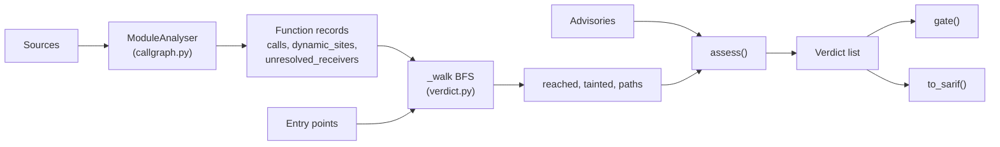

# Architecture

## Context

Vulnerability scanners match dependency versions against advisories and report every hit. Teams then have to decide which ones matter. `reachable` answers one narrower question: can any application entry point statically reach the vulnerable function the advisory names? It consumes source and advisories, and produces a verdict per advisory.

## Components

## Key decisions

**Three states, not two.** Collapsing `indeterminate` into `reachable` or `not-reachable` loses the information that matters most: where the analysis stopped being sure. The cost is a longer list than a two-state tool would give; the benefit is that a "not-reachable" verdict is sound with respect to everything the analyser can resolve.

**Unbounded versus bounded unknowns.** `getattr`, `eval`, `exec`, `__import__`, `importlib`, `globals`, `locals`, `vars` and `compile` can reach any function, so they taint the reachable set. A method call on an untyped receiver (for example a chained `.hexdigest()`) has a concrete but unknown target. Treating these as unbounded makes almost every real program fully indeterminate, so they are counted and reported separately. The trade-off is that a vulnerable method reached only through an untyped receiver can be missed; the reported count is how a reader sees that exposure.

**Taint is carried along the walk.** A node reached through a frame containing a dynamic site is marked tainted, and a node first reached cleanly is revisited if a tainted path reaches it later.

**Symbol-less advisories are never filtered.** With no function to aim at, reachability has nothing to say, so the verdict is `indeterminate`.

**Import binding.** `import a.b` binds only `a`. Binding it to `a.b` would silently rewrite the targets of other `a.*` calls.

## Failure modes

- Dynamic dispatch in the reachable set: every unreached advisory becomes `indeterminate`.
- Untyped receivers: counted in `unresolved_receiver_count`, not followed.
- Missing third-party source: calls into a module that was not supplied are leaf nodes; an advisory against a function inside it is reached only if the call target name matches.
- Wrong or incomplete entry points: verdicts are only as good as the entry-point list supplied.

## Out of scope

Finding dependencies, fetching advisories, fixing or upgrading packages, languages other than Python, and dynamic (runtime) analysis.
